<h1 align="center">IoT Streaming Data Warehouse</h1>

<p align="center">
  An event-driven reference architecture for simulating, processing, and analyzing industrial IoT telemetry.
</p>

<p align="center">
  
  
  
  
  
</p>

<p align="center">
  <a href="#architecture">Architecture</a> &middot;
  <a href="#setup-and-deployment">Setup</a> &middot;
  <a href="#operating-the-pipeline">Operations</a> &middot;
  <a href="#pipeline-verification">Verification</a>
</p>

<p align="center">
  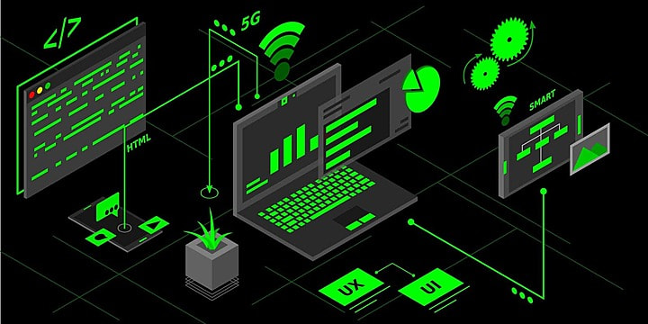
</p>

This project demonstrates a complete **real-time telemetry path**: simulated sensor readings are published to AWS, enriched and stored as real-time device state, continuously loaded into MotherDuck, and transformed into trusted analytical models.

> **Real-time and continuous by design:** EventBridge produces telemetry every minute, SQS buffers it immediately, the ETL Lambda reacts to queued events, and the local orchestrator continuously ingests warehouse events and runs dbt every 60 seconds.

| Capability | Implementation |
| --- | --- |
| Event production | EventBridge schedule and Python simulator Lambda |
| Real-time processing | Amazon SQS and an SQS-triggered ETL Lambda |
| Operational store | Amazon DynamoDB latest-device-state table |
| Analytical warehouse | MotherDuck Bronze ingestion with DuckDB |
| Data modeling | dbt Silver cleaning and Gold hourly aggregates |

## Architecture

<p align="center">
  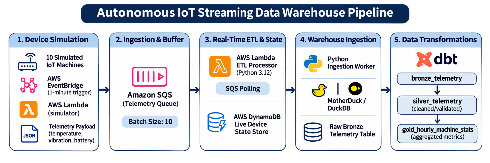
</p>

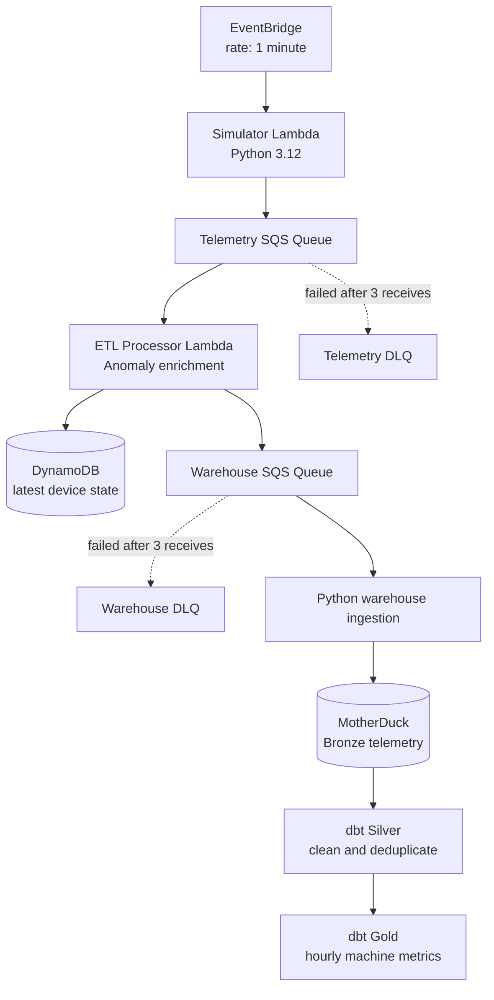
The AWS SAM stack provisions both queues and their dead-letter queues, the DynamoDB state table, an SQS-triggered ETL Lambda, and an EventBridge-scheduled simulator Lambda. The warehouse ingestion and dbt steps are run locally through the included Python orchestrator.

## Pipeline workflow

The solution runs as a **continuous real-time six-stage loop** for ten simulated industrial machines (`MACHINE-01` through `MACHINE-10`). AWS owns real-time generation, buffering, enrichment, and live state management; the local orchestrator continuously loads and models analytical data in MotherDuck.

### Stage 1 - Telemetry generation

AWS EventBridge invokes `src/generator/handler.py` every minute. The Simulator Lambda creates a randomized subset of 5-15 sensor readings, including temperature, vibration, battery, pressure, humidity, device status, and a unique event ID. It serializes the readings into JSON and sends them in SQS-safe batches of ten or fewer.

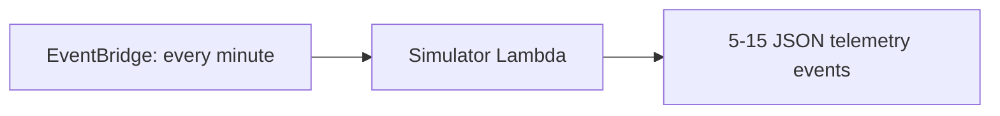

### Stage 2 - Ingestion and buffering

The simulator publishes raw events to `TelemetryQueue`. This standard SQS queue absorbs traffic bursts and separates telemetry generation from processing. Messages that cannot be processed after three receives move to `TelemetryDLQ` for inspection or replay.

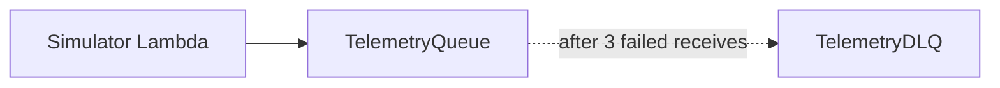

### Stage 3 - Real-time enrichment and state

New telemetry messages trigger `src/etl/handler.py` in batches of ten. The ETL Lambda evaluates threshold rules from `src/etl/thresholds.json`, appends `anomaly_status` and `anomaly_reasons`, upserts the latest record per `device_id` into `iotstream_device_state`, and routes the enriched event to `WarehouseQueue`.

Because DynamoDB uses `device_id` as its partition key, it serves as a compact real-time snapshot of the latest known state for the simulated devices.

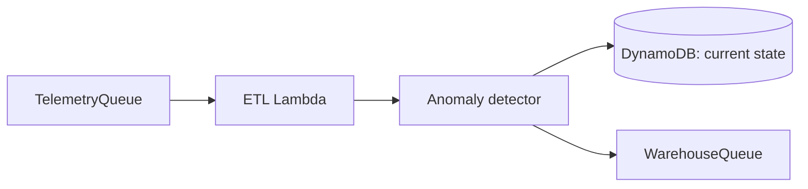

### Stage 4 - Continuous warehouse ingestion

`src/orchestrator.py` runs continuously and calls `src/warehouse/ingestion.py` once per 60-second cycle. The ingestion job polls `WarehouseQueue` with boto3, creates `bronze_telemetry` if necessary, writes events to MotherDuck with DuckDB, and deletes only successfully inserted SQS messages. It also supplies a processing timestamp if one is absent from the event.

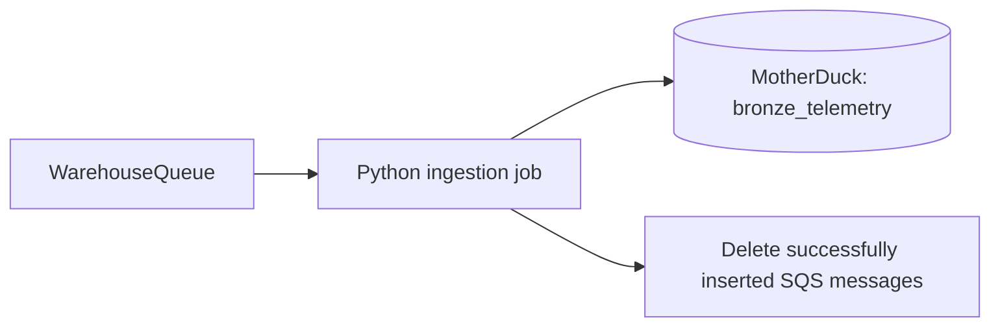

### Stage 5 - dbt transformations

Immediately after ingestion, the orchestrator executes `dbt run`. The Bronze layer retains historical enriched telemetry; `silver_telemetry` cleans, normalizes, types, and deduplicates it; `gold_hourly_machine_stats` aggregates hourly temperature, vibration, battery, event-volume, and anomaly metrics by machine and device.

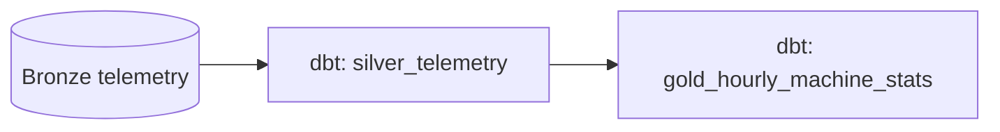

### Stage 6 - BI and analytics consumption

The Gold model is the analytics-facing layer for operational dashboards, reporting, or data science workloads. MotherDuck can be queried directly with DuckDB-compatible tools; Power BI or R can be connected separately through an appropriate DuckDB/ODBC integration when required.

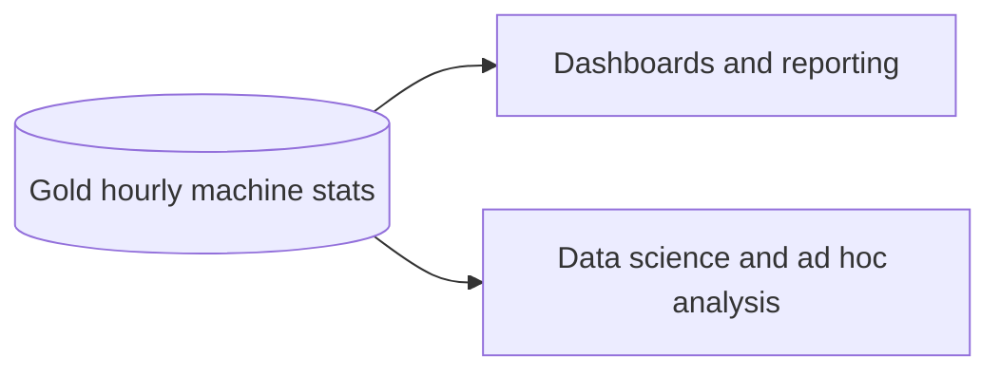

## Repository layout

```text
📁 infrastructure/
└── 📄 template.yaml                  AWS SAM infrastructure and Lambda wiring

📁 scripts/
└── 📄 preflight.py                   AWS credential and permission checks

📁 src/
├── 📁 generator/
│   └── 📄 handler.py                 Scheduled IoT simulator Lambda
├── 📁 etl/
│   ├── 📄 handler.py                 SQS-triggered enrichment and routing Lambda
│   ├── 📄 anomaly_detector.py        Threshold-based anomaly classification
│   └── 📄 thresholds.json            Anomaly thresholds
├── 📁 warehouse/
│   └── 📄 ingestion.py               Warehouse Queue to MotherDuck Bronze loader
├── 📁 transformations/
│   └── 📁 models/
│       ├── 📄 sources.yml            Bronze source declaration
│       ├── 📁 silver/                Cleaned, deduplicated telemetry model
│       └── 📁 gold/                  Hourly operational aggregates
└── 📄 orchestrator.py                Continuous local ingestion and dbt runner

📁 docs/
└── 📁 images/                        Architecture and verification screenshots
```

## Technology stack

| Area | Technologies | Role in the pipeline |
| --- | --- | --- |
| Cloud infrastructure | AWS SAM, CloudFormation | Defines and deploys the serverless resources. |
| Event scheduling and compute | EventBridge, AWS Lambda, Python 3.12 | Runs the autonomous simulator and ETL processor. |
| Messaging | Amazon SQS and DLQs | Buffers events, decouples stages, and captures failed messages. |
| Operational state | Amazon DynamoDB | Stores the latest enriched state for each device. |
| Warehouse | MotherDuck, DuckDB | Hosts and loads the historical telemetry data. |
| Transformations | dbt Core, dbt-duckdb | Builds tested Silver and Gold analytical models. |
| Python libraries | boto3, duckdb, python-dotenv | Provides AWS access, warehouse connectivity, and local configuration. |
| Optional analytics clients | DuckDB-compatible SQL tools, Power BI, R | Consume the Gold layer when separately configured. |

## Setup and deployment

### Prerequisites

- Python 3.12, matching the Lambda runtime
- AWS CLI configured for the target account
- AWS SAM CLI
- A MotherDuck account and access token
- Permission to use Lambda, EventBridge, SQS, DynamoDB, IAM, and CloudFormation

The SAM configuration targets `ap-south-1` by default; change `samconfig.toml` for a different region.

### 1. Create a Python environment

```powershell
py -m venv venv
.\venv\Scripts\Activate.ps1
pip install -r requirements.txt
```

### 2. Configure local variables

```powershell
Copy-Item .env.example .env
```

| Variable | Purpose |
| --- | --- |
| `TELEMETRY_QUEUE_URL` | Endpoint for the telemetry SQS queue. |
| `WAREHOUSE_QUEUE_URL` | Endpoint for the enriched-event SQS queue. |
| `DYNAMODB_TABLE_NAME` | Latest-state table; defaults to `iotstream_device_state`. |
| `MOTHERDUCK_TOKEN` | Authenticates DuckDB and dbt to `md:iotstream_db`. |

Keep `.env` private: it is ignored by Git and should never contain committed credentials.

### 3. Verify AWS access

```powershell
python scripts/preflight.py
```

The preflight script confirms the active identity and checks access to Lambda, SQS, DynamoDB, EventBridge, and IAM.

### 4. Build and deploy infrastructure

```powershell
sam build --template-file infrastructure/template.yaml
sam deploy --template-file infrastructure/template.yaml --config-file samconfig.toml
```

Copy the resulting queue URLs to `.env` for local tooling:

```powershell
aws cloudformation describe-stacks --stack-name iotstream-stack --query "Stacks[0].Outputs" --output table
```

After deployment, EventBridge invokes the simulator every minute and the ETL Lambda consumes telemetry automatically.

## Operating the pipeline

### Start the local warehouse and dbt loop

```powershell
python src/orchestrator.py
```

Each continuous 60-second cycle loads available warehouse messages into MotherDuck and immediately runs dbt transformations. This keeps Bronze, Silver, and Gold datasets close to the incoming real-time event stream; stop the loop with `Ctrl+C`.

### Run stages manually

```powershell
# Produce a telemetry batch.
python src/generator/handler.py

# Enrich telemetry, update DynamoDB, and route to the warehouse queue.
python src/etl/handler.py

# Load up to ten events into MotherDuck Bronze.
python src/warehouse/ingestion.py
```

### Run dbt directly

```powershell
dbt debug --project-dir src/transformations --profiles-dir src/transformations
dbt run --project-dir src/transformations --profiles-dir src/transformations
dbt test --project-dir src/transformations --profiles-dir src/transformations
```

The model tests cover unique and non-null event IDs, valid `ONLINE`/`OFFLINE` device statuses, and non-null battery values.

## Data model and transformations

The simulator emits `event_id`, `device_id`, `machine_id`, `event_timestamp`, `temperature`, `humidity`, `vibration`, `pressure`, `battery`, `device_status`, and `schema_version`. The ETL process adds `anomaly_status` and `anomaly_reasons`; the ingestion job ensures a `processing_timestamp` exists in Bronze.

| Signal | Rule | Result |
| --- | --- | --- |
| Temperature | At or above warning/critical threshold | `WARNING_TEMPERATURE` or `CRITICAL_TEMPERATURE` |
| Vibration | At or above critical threshold | `CRITICAL_VIBRATION` |
| Battery | At or below critical threshold | `CRITICAL_BATTERY` |
| Device status | `OFFLINE` | `DEVICE_OFFLINE` and `CRITICAL` status |

Tune the limits in `src/etl/thresholds.json` without changing the detector code.

| Layer | Model/table | Responsibility |
| --- | --- | --- |
| Bronze | `bronze_telemetry` | Ingested enriched events with minimal transformation. |
| Silver | `silver_telemetry` | Deduplicated events with normalized statuses and typed timestamps. |
| Gold | `gold_hourly_machine_stats` | Hourly device and machine operational aggregates. |

## Reliability and security

- Both queues use long polling, a 60-second visibility timeout, four-day retention, and a DLQ after three receives; DLQs retain messages for fourteen days.
- SQS isolates producer, ETL, and warehouse workloads so each stage can retry independently.
- SAM policy templates grant each Lambda only the queue and DynamoDB access it needs.
- DynamoDB uses 5 RCUs and 5 WCUs for predictable small-scale operational capacity.
- Store AWS credentials and the MotherDuck token in `.env` or a managed secrets service, never in source control.
- Silver-layer deduplication by `event_id` protects analytics from the at-least-once delivery semantics of SQS.

## Pipeline verification

### AWS SQS message flow

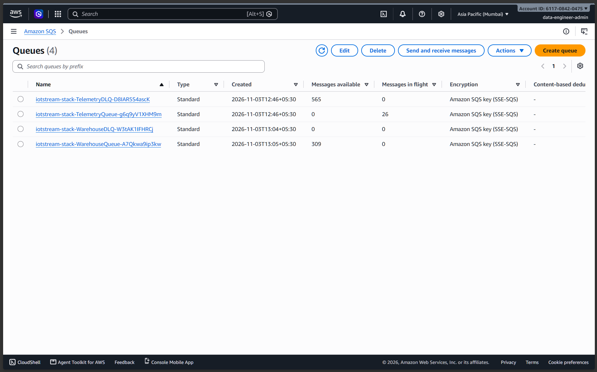

The SQS dashboard shows telemetry and warehouse messages flowing through the cloud queues. It verifies that scheduled simulation, queue buffering, and ETL routing are operating autonomously.

### DynamoDB real-time device state

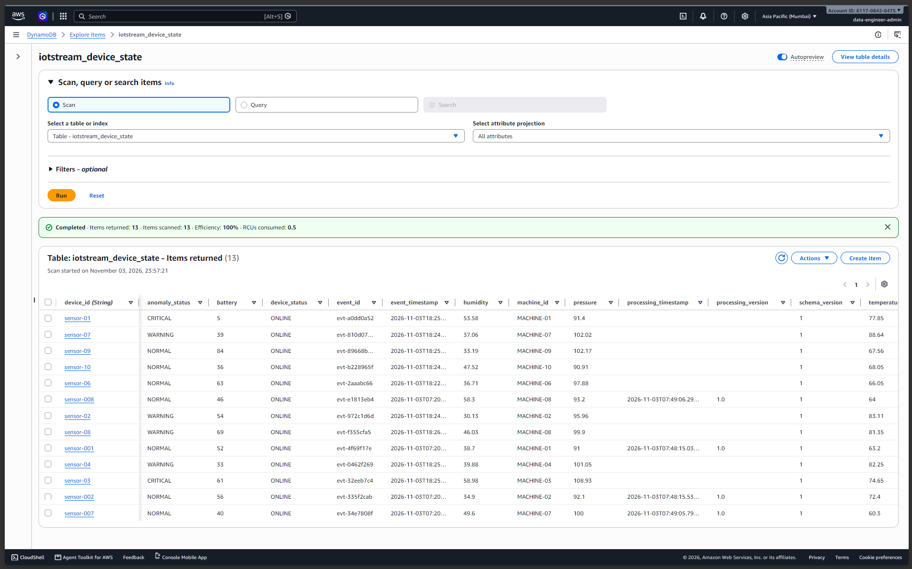

The DynamoDB table shows current records for simulated devices. This confirms that the ETL Lambda converts incoming telemetry into an up-to-date operational state view.

### Local orchestrator and dbt execution

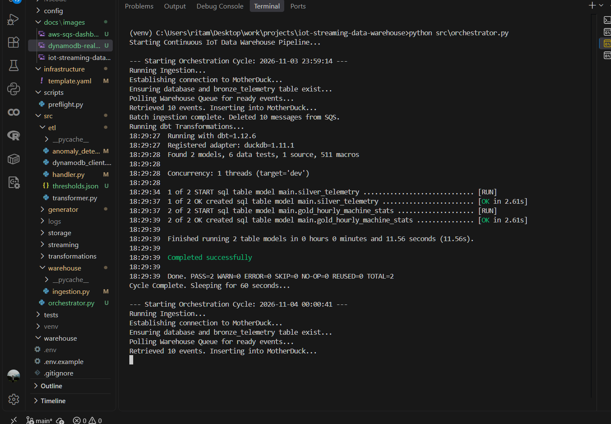

The terminal log records the local ingestion loop followed by dbt execution. It demonstrates the handoff from AWS-delivered events to repeatable warehouse transformations.

### MotherDuck Bronze and Gold layers

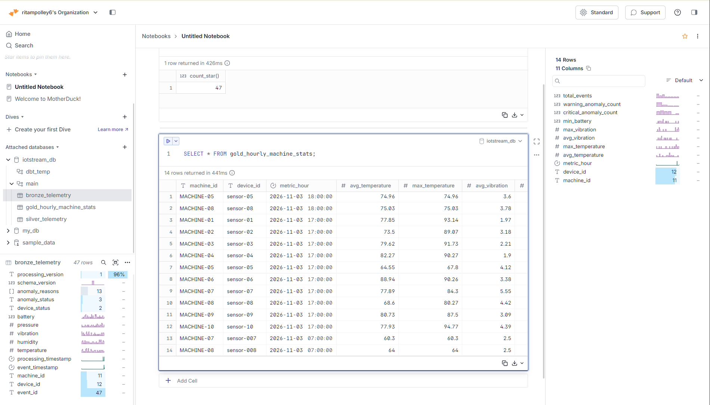

The MotherDuck UI shows populated Bronze data and aggregated Gold results. Together, these tables provide the final evidence that raw telemetry reaches an analytics-ready warehouse layer.

## Scalability

### Scenario 1 - Malformed sensor data and poison-pill handling

**Problem:** A firmware update could cause sensors to send malformed JSON or strings where numeric telemetry values are expected. If the ETL Lambda cannot parse a message, processing of that message fails.

**Response:** The architecture uses Amazon SQS dead-letter queues (DLQs). After three failed receives, as configured by `maxReceiveCount`, SQS moves the message to `TelemetryDLQ` instead of allowing a poison pill to repeatedly block normal processing. A CloudWatch alarm on DLQ depth can notify the engineering team to inspect the payload, correct the parser or producer, and redrive the retained messages without losing them.

### Scenario 2 - Fully cloud-native continuous ingestion

**Problem:** `src/orchestrator.py` currently runs locally to load MotherDuck and invoke dbt. If that machine stops, the continuous warehouse-ingestion loop also stops.

**Response:** Package the orchestrator and dbt environment in a Docker image and run it continuously on AWS ECS with Fargate. For short, event-driven workloads, the warehouse consumer can instead be redesigned as a Lambda function triggered by `WarehouseQueue`. Either approach removes the local-machine dependency while retaining MotherDuck as the serverless analytical warehouse.

### Scenario 3 - Scaling from 10 to 10,000 devices

**Problem:** SQS and Lambda scale automatically, but processing a much larger fleet in batches of ten could increase Lambda invocations and cost.

**Response:** Increase the SQS-to-Lambda event-source batch size, up to 1,000 where workload latency, timeout, and partial-failure handling permit, to process more records per invocation. At high analytical volumes, route enriched data to Amazon S3 through Kinesis Data Firehose and query the data lake from MotherDuck, reducing reliance on a second queue for bulk warehouse ingestion.

### Scenario 4 - Predictive maintenance with machine learning

**Problem:** The current ETL logic detects anomalies using static threshold rules; it cannot estimate whether a machine is likely to fail soon.

**Response:** Use the historical Bronze telemetry to train a predictive-maintenance model, such as Random Forest or XGBoost. Deploy the model behind an inference API or package it with the ETL runtime; the ETL Lambda can then append a `failure_probability` score to each live event before writing the operational state to DynamoDB and routing the event to MotherDuck.
