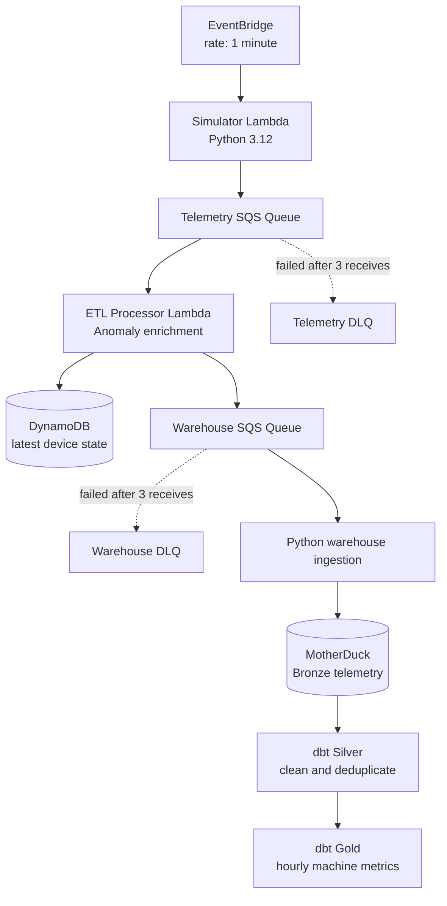

<h1 align="center">IoT Streaming Data Warehouse</h1>

<p align="center">
  An event-driven reference architecture for simulating, processing, and analyzing industrial IoT telemetry.
</p>

<p align="center">
  
  
  
  
  
</p>

<p align="center">
  <a href="#architecture">Architecture</a> &middot;
  <a href="#setup-and-deployment">Setup</a> &middot;
  <a href="#operating-the-pipeline">Operations</a> &middot;
  <a href="#pipeline-verification">Verification</a>
</p>

<p align="center">
  
</p>

This project demonstrates a complete telemetry path: simulated sensor readings are published to AWS, enriched and stored as real-time device state, loaded into MotherDuck, and transformed into trusted analytical models.

| Capability | Implementation |
| --- | --- |
| Event production | EventBridge schedule and Python simulator Lambda |
| Real-time processing | Amazon SQS and an SQS-triggered ETL Lambda |
| Operational store | Amazon DynamoDB latest-device-state table |
| Analytical warehouse | MotherDuck Bronze ingestion with DuckDB |
| Data modeling | dbt Silver cleaning and Gold hourly aggregates |

## Architecture

<p align="center">
  
</p>



```text
EventBridge schedule (every minute)
            |
            v
Simulator Lambda --> Telemetry SQS Queue --> Telemetry DLQ
                            |
                            v
                       ETL Lambda
                       |--> DynamoDB: latest device state
                       `--> Warehouse SQS Queue --> Warehouse DLQ
                                             |
                                             v
                           Local ingestion job / orchestrator
                                             |
                                             v
                              MotherDuck Bronze table
                                             |
                                             v
                                dbt Silver and Gold models
```

The AWS SAM stack provisions both queues and their dead-letter queues, the DynamoDB state table, an SQS-triggered ETL Lambda, and an EventBridge-scheduled simulator Lambda. The warehouse ingestion and dbt steps are run locally through the included Python orchestrator.

## Pipeline walkthrough

### 1. Simulate IoT telemetry

`src/generator/handler.py` is invoked every minute by `SimulatorFunction`. It generates 5-15 readings per run for simulated machines, each containing an event ID, device and machine IDs, UTC timestamp, temperature, humidity, vibration, pressure, battery, device status, and schema version.

The function serializes each reading to JSON and sends it to `TelemetryQueue`. Sends are split into groups of at most ten messages to comply with the SQS batch limit.

### 2. Buffer raw events with SQS

`TelemetryQueue` decouples the producer from ETL. It uses 20-second long polling, a 60-second visibility timeout, four-day retention, and sends messages that fail three times to `TelemetryDLQ` for inspection and replay.

### 3. Enrich and classify events in the ETL Lambda

`ETLProcessorFunction` consumes `TelemetryQueue` in batches of ten. `src/etl/handler.py` parses decimal telemetry safely for DynamoDB, then uses `AnomalyDetector` to add `anomaly_status` and `anomaly_reasons` to every event.

The detector reads `src/etl/thresholds.json` and classifies temperature, vibration, battery, and offline-device conditions as `NORMAL`, `WARNING`, or `CRITICAL`.

### 4. Store current device state in DynamoDB

The ETL Lambda writes each enriched event to `DeviceStateTable`. Because `device_id` is the table key, the newest reading replaces the prior state for that device, creating a low-latency operational view.

SAM supplies `DYNAMODB_TABLE_NAME` from `DeviceStateTable` and grants the Lambda table-scoped `DynamoDBCrudPolicy` permissions.

### 5. Route enriched data for analytics

The ETL Lambda sends the enriched event to `WarehouseQueue`. This isolates real-time state updates from warehouse loading. `WarehouseQueue` uses the same visibility, retention, long-polling, and DLQ strategy as the telemetry queue.

### 6. Load MotherDuck Bronze

`src/warehouse/ingestion.py` connects to `md:iotstream_db`, creates `bronze_telemetry` when needed, retrieves up to ten warehouse messages, and inserts the enriched fields into Bronze. It deletes SQS messages only after their corresponding inserts finish.

### 7. Transform Bronze into Silver and Gold

The dbt project in `src/transformations` models the MotherDuck data. `silver_telemetry` deduplicates events by `event_id`, normalizes statuses, and casts timestamps. `gold_hourly_machine_stats` aggregates clean telemetry per machine, device, and hour.

Gold outputs include average and maximum temperature and vibration, minimum battery level, anomaly counts, and total event volume for monitoring and reporting.

### 8. Run the warehouse loop

`src/orchestrator.py` runs the warehouse ingestion job, runs `dbt run`, then sleeps for 60 seconds before starting the next cycle. It provides a repeatable local bridge between the deployed AWS event path and MotherDuck transformations.

## Repository layout

```text
infrastructure/template.yaml          AWS SAM infrastructure and Lambda wiring
scripts/preflight.py                  AWS credential and permission checks
src/generator/handler.py              Scheduled IoT simulator Lambda
src/etl/handler.py                    SQS-triggered enrichment and routing Lambda
src/etl/anomaly_detector.py           Threshold-based anomaly classification
src/etl/thresholds.json               Anomaly thresholds
src/warehouse/ingestion.py            Warehouse Queue to MotherDuck Bronze loader
src/orchestrator.py                   Continuous local ingestion and dbt runner
src/transformations/models/sources.yml Bronze source declaration
src/transformations/models/silver/    Cleaned, deduplicated telemetry model
src/transformations/models/gold/      Hourly operational aggregates
docs/images/                          Architecture and verification screenshots
```

## Setup and deployment

### Prerequisites

- Python 3.12, matching the Lambda runtime
- AWS CLI configured for the target account
- AWS SAM CLI
- A MotherDuck account and access token
- Permission to use Lambda, EventBridge, SQS, DynamoDB, IAM, and CloudFormation

The SAM configuration targets `ap-south-1` by default; change `samconfig.toml` for a different region.

### 1. Create a Python environment

```powershell
py -m venv venv
.\venv\Scripts\Activate.ps1
pip install -r requirements.txt
```

### 2. Configure local variables

```powershell
Copy-Item .env.example .env
```

| Variable | Purpose |
| --- | --- |
| `TELEMETRY_QUEUE_URL` | Endpoint for the telemetry SQS queue. |
| `WAREHOUSE_QUEUE_URL` | Endpoint for the enriched-event SQS queue. |
| `DYNAMODB_TABLE_NAME` | Latest-state table; defaults to `iotstream_device_state`. |
| `MOTHERDUCK_TOKEN` | Authenticates DuckDB and dbt to `md:iotstream_db`. |

Keep `.env` private: it is ignored by Git and should never contain committed credentials.

### 3. Verify AWS access

```powershell
python scripts/preflight.py
```

The preflight script confirms the active identity and checks access to Lambda, SQS, DynamoDB, EventBridge, and IAM.

### 4. Build and deploy infrastructure

```powershell
sam build --template-file infrastructure/template.yaml
sam deploy --template-file infrastructure/template.yaml --config-file samconfig.toml
```

Copy the resulting queue URLs to `.env` for local tooling:

```powershell
aws cloudformation describe-stacks --stack-name iotstream-stack --query "Stacks[0].Outputs" --output table
```

After deployment, EventBridge invokes the simulator every minute and the ETL Lambda consumes telemetry automatically.

## Operating the pipeline

### Start the local warehouse and dbt loop

```powershell
python src/orchestrator.py
```

Each cycle loads available warehouse messages into MotherDuck, runs dbt transformations, and waits one minute. Stop it with `Ctrl+C`.

### Run stages manually

```powershell
# Produce a telemetry batch.
python src/generator/handler.py

# Enrich telemetry, update DynamoDB, and route to the warehouse queue.
python src/etl/handler.py

# Load up to ten events into MotherDuck Bronze.
python src/warehouse/ingestion.py
```

### Run dbt directly

```powershell
dbt debug --project-dir src/transformations --profiles-dir src/transformations
dbt run --project-dir src/transformations --profiles-dir src/transformations
dbt test --project-dir src/transformations --profiles-dir src/transformations
```

The model tests cover unique and non-null event IDs, valid `ONLINE`/`OFFLINE` device statuses, and non-null battery values.

## Data model and transformations

The simulator emits `event_id`, `device_id`, `machine_id`, `event_timestamp`, `temperature`, `humidity`, `vibration`, `pressure`, `battery`, `device_status`, and `schema_version`. The ETL process adds `anomaly_status` and `anomaly_reasons`; the ingestion job ensures a `processing_timestamp` exists in Bronze.

| Signal | Rule | Result |
| --- | --- | --- |
| Temperature | At or above warning/critical threshold | `WARNING_TEMPERATURE` or `CRITICAL_TEMPERATURE` |
| Vibration | At or above critical threshold | `CRITICAL_VIBRATION` |
| Battery | At or below critical threshold | `CRITICAL_BATTERY` |
| Device status | `OFFLINE` | `DEVICE_OFFLINE` and `CRITICAL` status |

Tune the limits in `src/etl/thresholds.json` without changing the detector code.

| Layer | Model/table | Responsibility |
| --- | --- | --- |
| Bronze | `bronze_telemetry` | Ingested enriched events with minimal transformation. |
| Silver | `silver_telemetry` | Deduplicated events with normalized statuses and typed timestamps. |
| Gold | `gold_hourly_machine_stats` | Hourly device and machine operational aggregates. |

## Reliability and security

- Both queues use long polling, a 60-second visibility timeout, four-day retention, and a DLQ after three receives; DLQs retain messages for fourteen days.
- SQS isolates producer, ETL, and warehouse workloads so each stage can retry independently.
- SAM policy templates grant each Lambda only the queue and DynamoDB access it needs.
- DynamoDB uses 5 RCUs and 5 WCUs for predictable small-scale operational capacity.
- Store AWS credentials and the MotherDuck token in `.env` or a managed secrets service, never in source control.
- Silver-layer deduplication by `event_id` protects analytics from the at-least-once delivery semantics of SQS.

## Pipeline verification

### AWS SQS message flow


The SQS dashboard shows telemetry and warehouse messages flowing through the cloud queues. It verifies that scheduled simulation, queue buffering, and ETL routing are operating autonomously.

### DynamoDB real-time device state


The DynamoDB table shows current records for simulated devices. This confirms that the ETL Lambda converts incoming telemetry into an up-to-date operational state view.

### Local orchestrator and dbt execution


The terminal log records the local ingestion loop followed by dbt execution. It demonstrates the handoff from AWS-delivered events to repeatable warehouse transformations.

### MotherDuck Bronze and Gold layers


The MotherDuck UI shows populated Bronze data and aggregated Gold results. Together, these tables provide the final evidence that raw telemetry reaches an analytics-ready warehouse layer.
